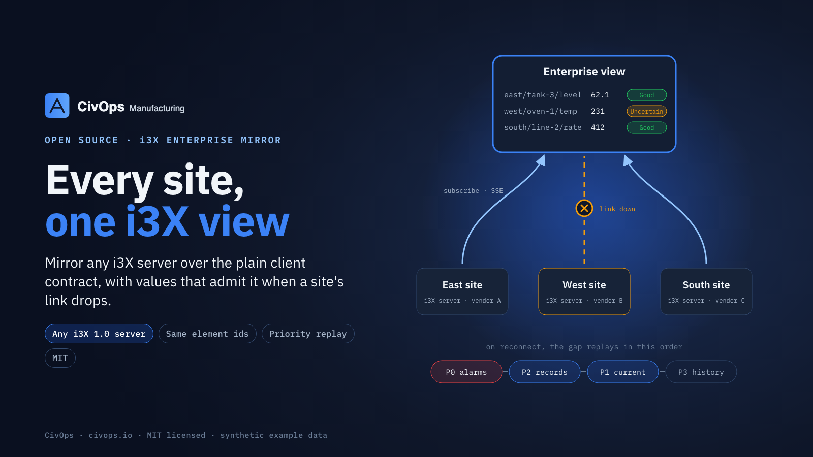

# i3X enterprise mirror

Mirrors any [CESMII i3X](https://www.cesmii.org/) 1.0 server (a site) into an enterprise view, over plain i3X. It reads the site's types and objects, subscribes to all of them, and holds the stream open, the same way any i3X client does, so the site does not need to know it is being mirrored and can come from any vendor. It is the enterprise tier of the [i3X Nexus Profile](https://github.com/LNS-Research/i3x-nexus-profile).



| Situation | What the enterprise view shows |
|---|---|
| Uplink up | the site's own element ids, hierarchy and relationships; values live from the stream; each point also goes to local history |
| Uplink down | every mirrored value **Uncertain**, last value kept: never shown Good, never blanked |
| Uplink back | the gap replayed with ordinary i3X reads, in order: **P0** (alarms, quality: history then current) → **P2** records → **P1** current values → **P3** history backfill; then live again |
| A write to a mirrored element | forwarded to the owning site with the **caller's own credential** (and Idempotency-Key); the site authorises it exactly as it would a direct write |

Replay classes come from the site's `/info` (`x-nexus.priorityByType`, published by an i3X Nexus) or from `priorityByType` in the upstream definition; anything unclassified is P1. Media bytes stay at the site; media and folder objects are mirrored as structure.

## Use

Requires Node 22 or later. No runtime dependencies. The package ships TypeScript source; run it with `tsx` or your own build.

```ts
import { UpstreamMirror, LastValueCache, MemoryHistory, MountedModel } from "./src/index";

const model = new MountedModel(), cache = new LastValueCache(), history = new MemoryHistory();
const siteA = new UpstreamMirror(
  { id: "site-a", url: "https://site-a.example/v1", token: process.env.SITE_A_TOKEN!,
    priorityByType: { "type:alarm": "P0" } },          // optional
  { model, cache, history });
await siteA.start();

cache.read("tank:t101/level");   // { value: 41.5, quality: "Good", … } or, while the uplink is down, "Uncertain"
siteA.replayLog;                  // [{ phase: "P0", elements, points }, { phase: "P2", … }, …] after a reconnect

// An enterprise i3X server routes a write on a mirrored element to its owner:
const owner = model.ownerOf("wo:1001");               // "site-a"
await siteA.forward("/objects/value", body, req.headers.authorization, req.headers["idempotency-key"]);
```

`MountedModel`, `LastValueCache` and `MemoryHistory` are minimal in-memory implementations of `MirrorModel`, `MirrorCache` and `MirrorHistory`. An enterprise i3X server plugs in its own address space, cache and history store by implementing those three interfaces. `examples/mirror-two-sites.ts` mirrors two sites into one view.

## Test

```bash
npm test
npm run typecheck
```

The tests run the mirror against a small in-process i3X site (`tests/fake-site.ts`) that can be taken off the network and brought back: same ids and relationships, values going Uncertain with the last value kept, the outage gap (an alarm that tripped and cleared while the uplink was down) replayed in priority order, and writes forwarded with the caller's token and refused by the site when the caller has no right. All data is synthetic.

## License

MIT. See [LICENSE](LICENSE). From [CivOps](https://civops.io).
